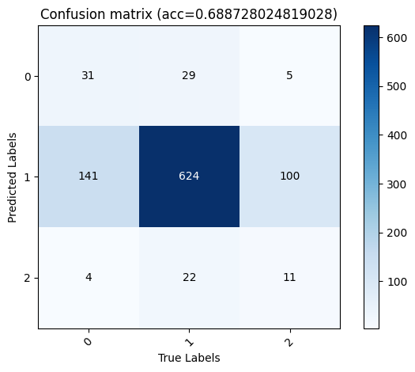

# eeg-attention-classification

A Flask web app that runs attention and memory tests while a 64-channel EEG cap records the participant, and a Random Forest that classifies each trial as a slow, typical or fast reaction from EEG band power. Télécom Paris first-year team project (PROJ104 "AIoT"), February to June 2024.



*Test confusion matrix of the pooled random split (rows: predicted, columns: true; 0 slow, 1 typical, 2 fast).*

## Results

Random Forest (100 trees) on 36 bands x 64 channels, from `notebooks/01_random_forest_eeg.ipynb`.

| Evaluation | Test trials | Accuracy | Majority-class baseline |
|---|---|---|---|
| Random 70/30 split, 4 subjects pooled (3,222 trials) | 967 | 0.689 | 0.698 |
| Random 70/30 split, 1 subject (706 trials) | 212 | 0.599 | 0.665 |
| Leave-one-subject-out (train on 3, test on the 4th) | 725 | 0.152 | 0.745 |

The classifier does not beat the majority-class baseline: with four subjects it overfits the training subjects.

## Quick start

```bash
pip install -r requirements.txt   # Python 3.12
cd webapp && python app.py        # run the tests in a browser
python -m classifier.train --manifest data/recordings.csv --subjects S1 S2 S3 --test-subject S4
```

The EEG recordings contain personal data and are not included. List your own in `data/recordings.csv` with columns `subject,xdf_path,db_path,email,session_id,test_id,double_sent`.

## Method

- Arrow tests (congruent and non-congruent flankers) log the reaction time and a time code in ms for every trial.
- The time codes cut the EEG recording into one window per trial, from the previous key press to the current one.
- Each window goes through a real FFT per channel and is averaged into 36 frequency bands, in dB.
- Labels per recording: fast below mu - sigma, slow above mu + sigma of the reaction times, typical otherwise.
- A scikit-learn `RandomForestClassifier` is trained on the flattened 36 x 64 features.

## Structure

```
webapp/       Flask app, attention tests and memory games
classifier/   EEG features, labels, training and evaluation
notebooks/    original experiments with outputs
docs/         test protocols and progress log (in French)
figures/
```

## Team

Students: Quentin Revillon, Charles Kayssieh, Félicité Yvert (attention tests), Prisha Chandiramani,
Manon Strasser (memory tests).

- Quentin Revillon: Flask back end and database, EEG/web-app synchronisation, signal processing, Random Forest classifier.
- Charles Kayssieh: arrow tests and leaderboard, reaction-time analysis and labelling.
- Félicité Yvert: attention-test protocol, non-congruent arrow test, password login, EEG recording sessions.
- Prisha Chandiramani: image-recall and word-sequence memory games, protocol for the ethics committee.
- Manon Strasser: number-sequence memory game.

Supervisor: Van-Tam Nguyen (Télécom Paris). PhD students: Nasim Bagheri Shouraki, Rémi Nahon, Aël Quélennec,
Yinghao Wang, Anh Dung Nguyen.
